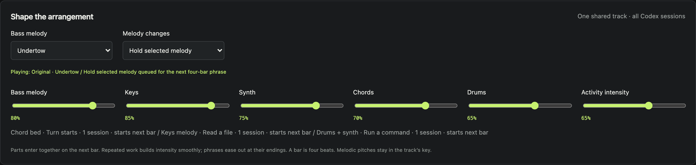

<h1 align="center">Session Score</h1>

**Hear what Codex is doing while you work. A bass line plays during a session, and each read, edit or command adds a part you can choose.**

[Listen to the 22-second Electronic sketch from the original prototype](https://raw.githubusercontent.com/OmTheLast/Session-Score/main/electronic.mp3)

Runs on your computer with Node.js 22 or later and local Codex session logs. Prompts and tool output stay out of the dashboard feed.

Built by Om Patnaik in November 2026. [Release v0.1.0](https://github.com/OmTheLast/Session-Score/releases/tag/v0.1.0)



## Install and hear your first session

| Platform | Install |
| --- | --- |
| macOS (tested) | Install Node.js 22 or later and clone the repository with the commands below. |

Start the dashboard, open the address printed in your terminal, and turn on **Link all Codex**. Send a prompt in Codex. You should hear bass when the session starts and see the action names as tools run.

```sh
git clone https://github.com/OmTheLast/Session-Score.git
cd Session-Score
npm run dev
```

To explore the controls before installing, download the listener guide and open it in your browser. Its screenshots show a sample session. [Download the listener guide](https://github.com/OmTheLast/Session-Score/raw/refs/heads/main/guide/index.html)

## Why

When you switch away from a long coding session, you lose track of whether the agent is searching, making changes or finished. Session Score follows the work across all your local Codex sessions. When the last one finishes, the music fades.

## Choose what an action sounds like

Pick Classical, Electronic or Hyperpop. Under **Make the rules**, try assigning keys to file reads and a drum groove to commands. Each part enters on the next bar, so events that happen at irregular times share a beat. You can set each part to last one, two, four or eight bars.

Under **Shape the arrangement**, hold one bass melody or rotate through ten. The mixer controls how much of each part you hear. Use **Export settings** to save a preset or share it with another listener.

## Notes from building it

I wanted to hear my own coding sessions as they happened. The early version could keep playing after Codex finished, so I tied playback to the start and end of a turn in the session log. Individual tool sounds still felt disconnected, so I gave them a shared bass melody and made them enter on bar boundaries.

## Commands

```sh
npm run dev            # Start the dashboard on port 8787
PORT=8788 npm run dev  # Choose another port on macOS
npm test               # Run the checks
```

## Verify it yourself

```sh
npm test
```

The tests follow sample session logs through the local HTTP server, including overlapping sessions, cancellations and reconnects. They also check that action phrases stay on the beat and that saved presets keep their settings.

## Credits and license

[Turbella](https://github.com/NakliTechie/turbella) provides the optional visualizer. Session Score uses the browser’s Web Audio API to play the music.

Session Score is available under the [MIT License](LICENSE).

[Listener guide](guide/index.html) · [Action rules](ACTIONS.md) · [Earlier audio sketches](samples/README.md) · [Changelog](CHANGELOG.md)
